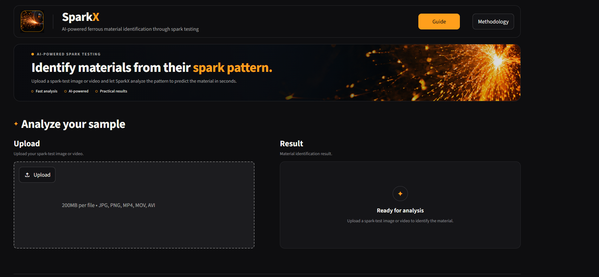
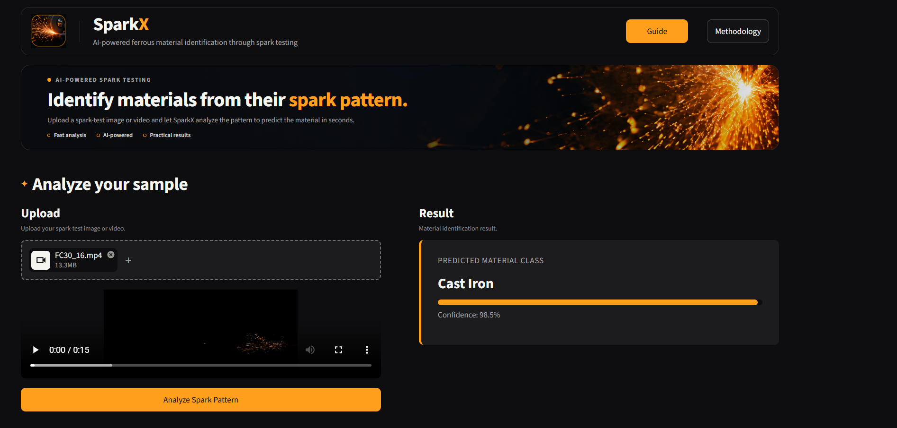
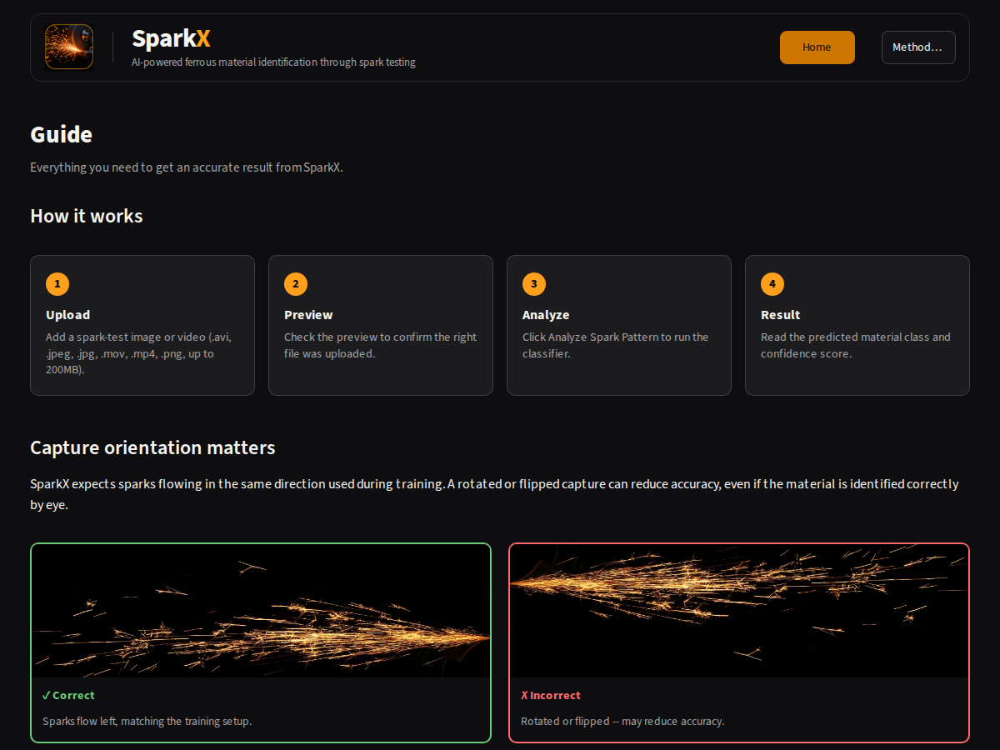
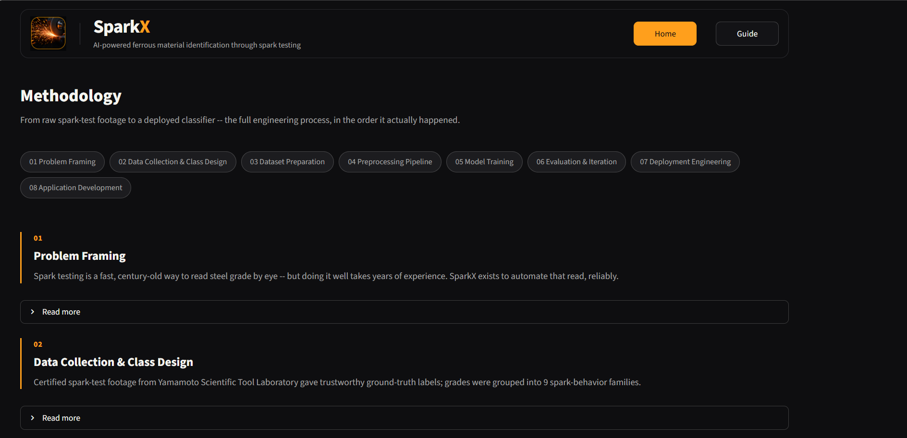

# SparkX

**AI-powered ferrous material identification through spark testing.**



## What is SparkX?

Spark testing is a quick, low-cost way to determine what a ferrous material is made of. You press the metal against a grinding wheel, and the sparks it throws off — their color, length, and how they branch — tell you something about the material. The catch is that reading those sparks accurately takes years of hands-on experience.

SparkX automates that read. Upload a photo or short video of a spark test, and it identifies the material class in seconds using a machine learning model trained on real spark-test footage.

## Key Features

- Accepts a single **image** or a **video** clip
- Identifies material across **10 classes** of ferrous metal
- Runs on **TensorFlow Lite** for fast, lightweight inference
- Averages predictions across multiple video frames for a more reliable result
- Built-in **Guide** page explaining how to get an accurate capture
- Built-in **Methodology** page covering the complete process, model performance, confusion matrix, and per-class recall
- Clean, responsive interface for both desktop and mobile
## Demo / Screenshots

**A completed result:**


**Guide page:**


**Methodology page:**


🚀 **Live Demo:** [Try SparkX](https://sparkx.streamlit.app)

## Tech Stack

- **Streamlit** — web app framework
- **TensorFlow Lite** — model inference
- **MobileNetV2** — model backbone (fine-tuned)
- **OpenCV** — video frame handling and image resizing
- **Pillow** — image loading

## How It Works

SparkX uses a MobileNetV2 model fine-tuned on 2,366 real spark-test images to classify spark patterns into one of 10 material classes. These classes provide a broad classification of ferrous materials based on their spark characteristics.
They are not intended to identify exact steel grades.

For a video, the app samples several frames, runs each one through the model, and averages the results to make a final, more reliable prediction.

Want the full story — how the data was collected, why these classes were chosen, and every fix made along the way? Check the **Methodology** page inside the app.

## Model Performance

The model reaches 79.2% accuracy on a held-out validation set of 447 images across all 10 classes.

Some classes perform much better than others — materials with a very distinct spark pattern (like cast iron and pure iron) are identified almost perfectly, while a few visually similar classes are harder to tell apart. The full confusion matrix and per-class breakdown are available on the in-app **Methodology** page.

## Getting Started

**1. Clone the repository**
```bash
git clone https://github.com/shubhamnagane2205-stack/sparkx.git
cd sparkx
```

**2. Create a virtual environment (recommended)**
```bash
python -m venv venv
source venv/bin/activate   # on Windows: venv\Scripts\activate
```

**3. Install dependencies**
```bash
pip install -r requirements.txt
```

**4. Run the app**
```bash
streamlit run app.py
```

The app will open in your browser at `http://localhost:8501`.

## Project Structure

```
sparkx/
├── app.py                    # Entry point — switches between screens
├── config.py                 # App-wide settings (paths, class names, etc.)
├── requirements.txt
├── LICENSE
├── .streamlit/
│   └── config.toml           # Streamlit theme settings
├── screens/
│   ├── home_screen.py        # Main upload + analyze screen
│   ├── guide_screen.py       # "How to use" page
│   └── methodology_screen.py # Full project write-up + model metrics
├── UI/
│   ├── styles.py                       # All custom styling and reusable UI components
│   ├── SparkX.png                      # Logo
│   ├── Hero_Sec.png                    # Hero background image
│   ├── guide_orientation_correct.png   # Guide page example: correct capture
│   └── guide_orientation_incorrect.png # Guide page example: incorrect capture
├── src/
│   ├── preprocessing.py      # Image resizing and normalization
│   ├── inference.py          # Runs the model and returns a prediction
│   ├── validation.py         # Checks uploaded files are valid
│   └── video_utils.py        # Samples frames from an uploaded video
├── metrics/
│   └── val_metrics.json      # Validation accuracy and confusion matrix
└── model/
    └── SparkLite.tflite      # The trained model
```

## Known Limitations

Being upfront about what this project is — and isn't:

- **Not built for heavy traffic.** This is a single-session Streamlit app, not a production web service. It's meant for demos and personal use, not many people at once.
- **Some classes have less training data.** A few classes (like pure iron and cast iron) only had one real source video each, because that's all the reliable footage available for them. They still perform well, since their spark patterns are quite distinct, but it's a real limitation worth knowing about.
- **Orientation matters.** The model expects sparks flowing in the same direction they did during training. The Guide page explains how to get this right.

## Data & Acknowledgments

Training footage was sourced from **Yamamoto Scientific Tool Laboratory (YSTL)**, using their certified spark-test reference videos. Material classes are grouped based on the **JIS (Japanese Industrial Standards)** steel grading system.

## License / Author

Built by **Shubham Nagane**.

This project is licensed under the [MIT License](LICENSE).
